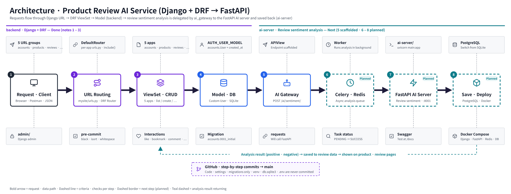

# product-review-ai-service — Product Review AI Service

<p align="right"><a href="README.md">한국어</a> | <b>English</b></p>

<p align="center">
  
  
  
  
  
  <br>
  
  
  
  
</p>

## About

### Architecture

User requests are handled in the order **Django URL → DRF ViewSet → Model** (backend). Review **sentiment analysis** is delegated by `ai_gateway` to the **FastAPI AI server**, and the result is saved back to the review data and shown on screen (ai-server). Steps **1 – 4 are done**, step 5 is an **endpoint scaffold**, and steps 6 – 8 are **planned**.



<br>

### Overview

A personal practice project from the **Django & FastAPI service building** course. The goal is to **separate** a **service server (Django + DRF)** that handles products and reviews from an **AI server (FastAPI)** that analyzes reviews. Because they ship together as one service, `backend/` and `ai-server/` live in **one repository (monorepo)**.

The focus is not on building many features at once but on **getting the structure right first**: apps split by role, URL · View · Model separated per app, and commits pushed **in the order they were built**.

<br>

### Results

| Area | Key result |
|---|---|
| Structure | `backend/` (Django + DRF) · `ai-server/` (FastAPI, planned) **monorepo** · root + per-folder **pre-commit** |
| App design | **5 apps** by role — accounts · products · reviews · interactions · ai_gateway |
| Routing | `mysite/urls.py` → per-app `urls.py` via `include()` · DRF **DefaultRouter** |
| API scaffold | **CRUD methods** defined on ViewSets (list · retrieve · create · update · destroy) · to be implemented |
| Model | **Custom User** (`AbstractUser` + `created_at`) · `AUTH_USER_MODEL = accounts.User` · migration `0001_initial` |
| AI integration | `POST /ai/sentiment/` endpoint scaffold → will connect to a FastAPI sentiment server |

<br>

### API

| URL | App | Purpose | Status |
|---|---|---|---|
| `/admin/` | Django | Admin site | Working |
| `/accounts/users/` | accounts | User list · detail | Scaffold |
| `/products/` | products | Product CRUD | Scaffold |
| `/reviews/` | reviews | Review CRUD | Scaffold |
| `/interactions/likes/` · `bookmarks/` · `comments/` · `reports/` | interactions | Review like · bookmark · comment · report | Scaffold |
| `/ai/sentiment/` | ai_gateway | Review sentiment request (POST) | Scaffold |

*Scaffold = URL and ViewSet methods are wired. Real behavior (serializers · DB handling) comes in the next steps.*

<br>

### Development steps

| # | Commit | Content |
|---|---|---|
| 1 | `chore` Initial setup | `.gitignore` · pre-commit (root · backend · ai-server) |
| 2 | `feat` Create Django project | `mysite` settings · `requirements.txt` |
| 3 | `feat` Create 5 apps | accounts · products · reviews · interactions · ai_gateway |
| 4 | `feat` Models | Custom User · accounts migration |
| 5 | `feat` Wire URL · View | Per-app Router · ViewSet CRUD scaffold |
| Next | Planned | Serializers · JWT auth · templates · FastAPI AI server · Celery · Docker |

<br>

### Folders

| Folder | What it is | Key points |
|---|---|---|
| [**backend**](backend/) | **Service server** — Django + DRF · product · review · user · interaction APIs | 5 apps · Router · ViewSet · Custom User |
| [**ai-server**](ai-server/) | **AI server** — FastAPI review sentiment analysis (planned) | pre-commit config · built in a later step |

<br><br>

## Quick Start

Requirements: Windows 11 PC · Ubuntu (WSL2)

**Step 1 · Install WSL (once)** — run PowerShell **as administrator**

```powershell
wsl --install
```

**Step 2 · Clone** — in the Ubuntu window

```bash
sudo apt update && sudo apt install -y git python3-venv
git clone https://github.com/sunghyunglee/product-review-ai-service.git ~/product-review-ai-service
```

**Step 3 · Install and run backend**

```bash
cd ~/product-review-ai-service/backend
python3 -m venv .venv && source .venv/bin/activate
pip install -r requirements.txt
python manage.py migrate
python manage.py runserver
```

If http://127.0.0.1:8000/admin/ opens in the browser, it works. Create an admin account with `python manage.py createsuperuser`.

<br><br>

## Notes

- **Never commit `.env` · `db.sqlite3` · `venv/` · `.venv/` · `media/`** — excluded by `.gitignore`.
- `SECRET_KEY` is the development default. Move it to `.env` before deploying.
- Commits are split by feature; add files **by name** instead of `git add .`.
