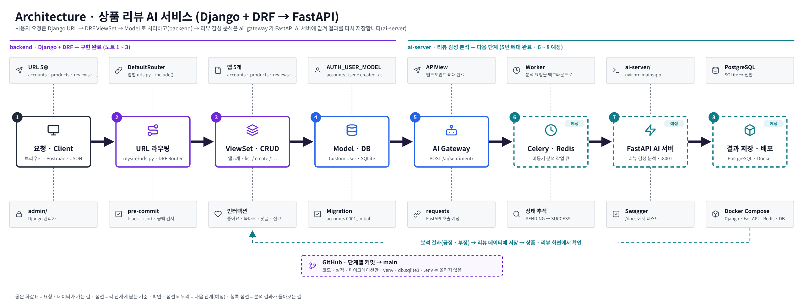

# product-review-ai-service — 상품 리뷰 AI 서비스

<p align="right"><b>한국어</b> | <a href="README.en.md">English</a></p>

<p align="center">
  
  
  
  
  
  <br>
  
  
  
  
</p>

## 프로젝트 소개

### Architecture

사용자 요청은 **Django URL → DRF ViewSet → Model** 순서로 처리합니다(backend). 리뷰 **감성 분석**은 `ai_gateway` 가 **FastAPI AI 서버**에 맡기고, 분석 결과는 다시 리뷰 데이터에 저장해 화면에서 확인합니다(ai-server). 현재는 **1 ~ 4번이 완성**, 5번은 **엔드포인트 뼈대**, 6 ~ 8번은 **다음 단계(예정)** 입니다.



<br>

### 개요

**Django & FastAPI 기반 서비스 구축** 과정에서 만든 개인 실습 프로젝트입니다. 상품 · 리뷰를 다루는 **서비스 서버(Django + DRF)** 와 리뷰를 분석하는 **AI 서버(FastAPI)** 를 **분리하는 구조**를 목표로 합니다. 하나의 서비스로 같이 배포되므로 **한 저장소(Monorepo)** 에 `backend/` · `ai-server/` 를 함께 둡니다.

목표는 기능을 한 번에 많이 만드는 것이 아니라 **구조를 먼저 바르게 잡는 것**입니다. 앱을 역할별로 나누고, URL · View · Model 을 앱 단위로 분리하고, 커밋은 **만든 순서대로** 나눠 올렸습니다.

<br>

### 작업 결과

| 구분 | 핵심 결과 |
|---|---|
| 구조 | `backend/` (Django + DRF) · `ai-server/` (FastAPI 예정) **Monorepo** · 루트 + 폴더별 **pre-commit** |
| 앱 설계 | 역할별 앱 **5개** — accounts · products · reviews · interactions · ai_gateway |
| 라우팅 | `mysite/urls.py` 에서 앱별 `urls.py` 로 `include()` · DRF **DefaultRouter** |
| API 뼈대 | ViewSet 으로 **CRUD 메서드** 정의 (list · retrieve · create · update · destroy) · 구현 예정 |
| 모델 | **Custom User** (`AbstractUser` + `created_at`) · `AUTH_USER_MODEL = accounts.User` · 마이그레이션 `0001_initial` |
| AI 연동 | `POST /ai/sentiment/` 엔드포인트 뼈대 → FastAPI 감성 분석 서버 연결 예정 |

<br>

### API 구조

| URL | 앱 | 내용 | 상태 |
|---|---|---|---|
| `/admin/` | Django | 관리자 화면 | 동작 |
| `/accounts/users/` | accounts | 회원 목록 · 상세 | 뼈대 |
| `/products/` | products | 상품 CRUD | 뼈대 |
| `/reviews/` | reviews | 리뷰 CRUD | 뼈대 |
| `/interactions/likes/` · `bookmarks/` · `comments/` · `reports/` | interactions | 리뷰 좋아요 · 북마크 · 댓글 · 신고 | 뼈대 |
| `/ai/sentiment/` | ai_gateway | 리뷰 감성 분석 요청 (POST) | 뼈대 |

*뼈대 = URL 과 ViewSet 메서드까지 연결된 상태입니다. 실제 동작(Serializer · DB 처리)은 다음 단계에서 채웁니다.*

<br>

### 개발 단계

| 순서 | 커밋 | 내용 |
|---|---|---|
| 1 | `chore` 프로젝트 초기 설정 | `.gitignore` · pre-commit (루트 · backend · ai-server) |
| 2 | `feat` Django 프로젝트 생성 | `mysite` 설정 · `requirements.txt` |
| 3 | `feat` 앱 5개 생성 | accounts · products · reviews · interactions · ai_gateway |
| 4 | `feat` 모델 생성 | Custom User · accounts 마이그레이션 |
| 5 | `feat` URL · View 연결 | 앱별 Router · ViewSet CRUD 뼈대 |
| 다음 | 예정 | Serializer · JWT 인증 · 템플릿 · FastAPI AI 서버 · Celery · Docker |

<br>

### 바로가기

| 폴더 | 무엇인가 | 핵심 |
|---|---|---|
| [**backend**](backend/) | **서비스 서버** — Django + DRF · 상품 · 리뷰 · 회원 · 인터랙션 API | 앱 5개 · Router · ViewSet · Custom User |
| [**ai-server**](ai-server/) | **AI 서버** — FastAPI 리뷰 감성 분석 (예정) | pre-commit 설정 · 다음 단계에서 구현 |

<br><br>

## 빠른 시작

준비물: Windows 11 PC · Ubuntu (WSL2)

**1단계 · WSL 설치 (처음 한 번)** — PowerShell 을 **관리자 권한으로 실행**

```powershell
wsl --install
```

**2단계 · 받기** — Ubuntu 창에서

```bash
sudo apt update && sudo apt install -y git python3-venv
git clone https://github.com/sunghyunglee/product-review-ai-service.git ~/product-review-ai-service
```

**3단계 · backend 설치 · 실행**

```bash
cd ~/product-review-ai-service/backend
python3 -m venv .venv && source .venv/bin/activate
pip install -r requirements.txt
python manage.py migrate
python manage.py runserver
```

브라우저에서 http://127.0.0.1:8000/admin/ 이 열리면 성공입니다. 관리자 계정은 `python manage.py createsuperuser` 로 만듭니다.

<br><br>

## 주의사항

- **`.env` · `db.sqlite3` · `venv/` · `.venv/` · `media/` 는 Git 금지** — `.gitignore` 로 제외합니다.
- `SECRET_KEY` 는 개발용 기본값입니다. 배포 전에는 `.env` 로 분리합니다.
- 커밋은 기능 단위로 나누고, `git add .` 대신 **파일 이름으로만 add** 합니다.
